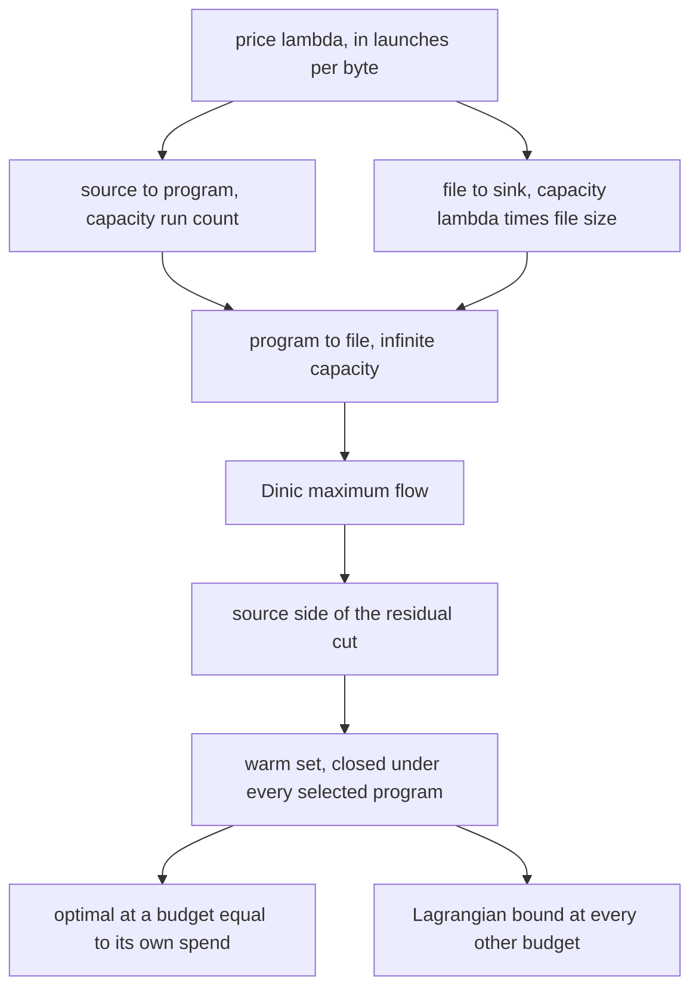
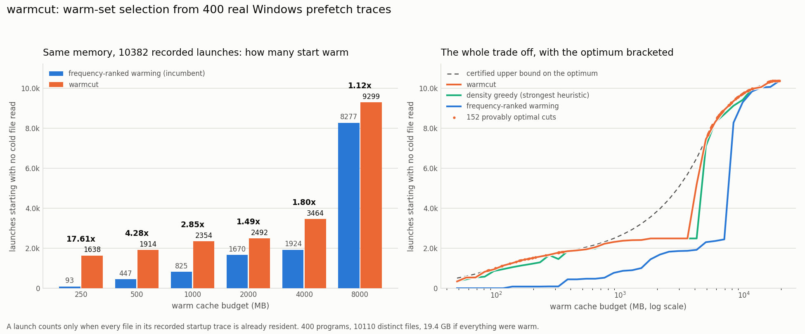

# warmcut

Pick which files to keep warm so that whole program launches, not isolated hot files, stop touching the disk. The choice is made exactly, by a parametric minimum cut over 400 real Windows prefetch traces.

## The problem

Every cache warming policy in wide use ranks items by how much demand they carry: most frequently used first, most recently used first, highest hit rate per byte first. That ranking is right when each item pays off on its own.

Program startup is not like that. A program start reads a whole dependency set, and the cost that a user feels is dominated by whether it had to go to disk at all. Readahead issues the misses in parallel, so one missing DLL costs nearly what ten missing DLLs cost. Benefit is a step function of the set, not a sum over items.

Frequency ranking is blind to that step. It will happily spend a cache budget warming the nine hottest files of a ten file program and buy exactly nothing, because the tenth file still faults and the launch still stalls. On the traces in this repository that failure is not a corner case. At a 250 MB budget, frequency ranked warming leaves 93 of 10382 recorded launches fault free. The optimum at the same 250 MB is 1638.

## What this does

`warmcut` reads the prefetch records Windows already keeps in `C:/Windows/Prefetch`, turns them into an exact optimization instance, and solves it.

1. Parses the SCCA records (versions 23 to 31), decompressing the MAM container through `ntdll!RtlDecompressBufferEx` because the XPRESS HUFFMAN decompressor is only guaranteed to exist inside Windows itself.
2. Resolves every NT path in each trace to its real on-disk byte size, and drops paths that no longer resolve rather than guessing at them (6878 of 50858 here, almost all temporary files).
3. Redacts: paths under the Windows directory are kept verbatim because they are identical on every machine, every other path and every image name becomes an opaque identifier. The committed instance carries the real structure, the real byte costs and the real launch counts, and nothing personal.
4. Solves `maximise launches that start fault free, minus price times resident bytes` as a maximum closure problem, which is one minimum cut.
5. Sweeps the price to trace the complete upper concave envelope of the launches against memory trade off, then repairs inside the gaps the envelope leaves and reports a certified optimality gap at any budget.

A launch counts as fault free only when every file in its recorded startup trace is already resident. That is the whole metric, it is countable, and nothing about it is modelled or simulated.

## Why it is interesting

The AND structure is what makes this exactly solvable rather than merely approximable.

If a launch earned partial credit for partial residency, the objective would be a sum over files and a ratio greedy would be optimal. Because it earns nothing until the set is complete, programs are profit nodes that depend on cost nodes, and the problem is the maximum closure problem: polynomial, and solved exactly by a single minimum cut. The same AND structure that breaks frequency ranking is the structure that hands you the exact algorithm.

Two further things fell out of the real data and are worth stating plainly.

**The envelope is not smooth, and the jump is enormous.** The sweep finds 152 distinct provably optimal warm sets, but there is no optimal cut anywhere between 347 MB and 5095 MB. Below that price the shared dependency core of a large group of programs is not worth buying; above it the whole group becomes worth buying at once. This machine has no good warm cache size in that range, which is a real operational statement, not an artifact of sampling: the sweep is Eisner and Severance parametric search, which enumerates every vertex of the envelope exactly rather than probing prices on a grid.

**The exact solver is necessary against the incumbent, and nearly unnecessary against a good heuristic.** At the budgets where a cut is provably optimal, frequency ranking is 1.01x to 18.03x away, but a density greedy that reasons about whole programs lands within 0 to 3 percent. Saying so is more useful than hiding it. What the heuristic cannot produce is the bound: at a 2 GB budget the best set found serves 2492 launches and the certificate says no set can serve more than 3855, so the remaining 35 percent is a measured open question rather than an unknown. And inside the gap region the cut guided repair does beat the heuristic outright, 3464 against 2492 at 4 GB.

## Architecture

FigJam board: https://www.figma.com/board/0P7zmKx2wqN4yAokltMy2S

The board traces one run end to end: prefetch records are decompressed and parsed, resolved against the file system for real byte costs, redacted, and emitted as a committed instance; the instance becomes a flow network whose minimum cut is an exact warm set; the price sweep turns single cuts into the full envelope plus a bound; and the repair stage converts that into an answer at any budget with its optimality gap attached.

The solver core, as code:



The infinite capacity on the program to file arcs is what forces the cut to be closed: no minimum cut will ever sever one, so selecting a program forces every file it needs onto the source side.

## Results



The metric is the number of recorded launches that start with no cold file read: a launch counts only when every file in its own prefetch trace is already resident. The corpus is this machine's 400 prefetch records, which between them hold 10382 recorded launches across 10110 distinct files; warming everything would cost 19.4 GB.

The baseline is frequency ranked warming, the policy class a real prefetcher uses: rank files by demand carried per byte, fill the cache in that order. The comparison is at matched memory, and every number below came out of `scripts/demo.py` reading the committed instance.

| warm cache | frequency ranked | warmcut | gain | certified bound | gap |
|---|---|---|---|---|---|
| 250 MB | 93 | 1638 | 17.61x | 1645 | 0.5% |
| 500 MB | 447 | 1914 | 4.28x | 2013 | 4.9% |
| 1000 MB | 825 | 2354 | 2.85x | 2627 | 10.4% |
| 2000 MB | 1670 | 2492 | 1.49x | 3855 | 35.3% |
| 4000 MB | 1924 | 3464 | 1.80x | 6309 | 45.1% |
| 8000 MB | 8277 | 9299 | 1.12x | 9304 | 0.0% |

What changed is where the budget goes. Frequency ranking spreads it across the hottest files in the system and completes almost no program; warmcut buys whole dependency closures and completes as many as the budget allows. The gain is largest where memory is scarcest, because that is where partial coverage wastes the most, and it narrows at 8 GB simply because by then most of the corpus is resident under either policy.

The gap column is the honest part. It is the distance between the best set found and the Lagrangian upper bound from the price sweep, so it is a measured bound on how much is left, not an error bar. It is near zero wherever a provably optimal cut lands close to the requested budget, and it opens up to 45 percent inside the 347 MB to 5095 MB envelope gap, where no cut exists and only the repair heuristics are available.

Against the strongest heuristic rather than the incumbent, at the budgets where the cut is provably optimal:

| budget | provable optimum | density greedy | frequency ranked |
|---|---|---|---|
| 154.8 MB | 1385 | 1120 | 86 |
| 347.2 MB | 1826 | 1826 | 396 |
| 5459.7 MB | 8046 | 7939 | 2362 |
| 6681.0 MB | 8833 | 8629 | 2446 |
| 9055.5 MB | 9591 | 9318 | 8821 |

Density greedy is close, and at 347 MB it is exactly optimal. The demo asserts on every one of the 152 optimal cuts that no heuristic beats the cut, which is a live check on the solver rather than a claim.

### Generalisation

Optimising and scoring on the same launch counts would be an oracle reading its own test set, so the demo also splits them. Each program's run count is split by a binomial draw, the warm set is chosen from the fitted 7268 launches only, and it is scored on the held out 3114. Twenty three programs drew a fitted share of zero and so were invisible to the chooser while still being scored.

| warm cache | frequency ranked | warmcut | gain |
|---|---|---|---|
| 500 MB | 124 | 566 | 4.56x |
| 1000 MB | 234 | 706 | 3.02x |
| 2000 MB | 490 | 746 | 1.52x |
| 4000 MB | 567 | 1046 | 1.84x |
| 8000 MB | 2435 | 2794 | 1.15x |

The advantage survives the split, which is the result that matters: the gain is not an artifact of fitting the exact run counts.

### Where it does not work

A harsher split fits the warm set on 70 percent of the programs and scores it on 120 programs the chooser never saw at all. There warmcut loses to frequency ranking at two of three budgets (112 against 197 at 1 GB, 152 against 219 at 4 GB, 326 against 312 at 8 GB), even though it leaves more of the held out programs' bytes resident at 1 GB and 8 GB.

That is the expected and correct outcome, and it bounds what this method is for. A closure is tuned to specific programs; an unseen program brings private files that no amount of tuning on other programs can have warmed, so the all or nothing metric collapses for it. Frequency ranking, being program agnostic, transfers marginally better. warmcut is a tool for a known workload (a build agent, a kiosk, a CI image, a laptop whose own prefetch history is the input), not a general replacement for a demand paged cache policy.

## How to run it

Python 3.9 or newer. The solver and the parser need nothing outside the standard library; matplotlib is used only to draw the chart.

```
pip install -r requirements.txt
```

Reproduce every number in this README from the committed instance, which needs no Windows and no prefetch directory:

```
python scripts/demo.py
python scripts/make_chart.py
```

`scripts/demo.py` takes about 95 seconds, 35 of which are the price sweep. It writes `docs/results.json`; `scripts/make_chart.py` turns that into `docs/before_after.png`.

Build an instance from your own machine instead (Windows only, no elevation required):

```
python scripts/harvest.py
python scripts/demo.py
```

Run the tests, which include brute force equivalence checks against exhaustive enumeration on small random instances:

```
python -m pytest tests -q
```

Use the solver directly:

```python
from fractions import Fraction
from warmcut import WarmSetInstance, Frontier, best_at_budget

instance = WarmSetInstance.load("data/instance.json")
frontier = Frontier(instance)
frontier.envelope()

answer = best_at_budget(instance, frontier, budget=1000 * 10**6)
print(answer.launches, len(answer.warm), answer.gap)
```

## Example output

A real run of `python scripts/demo.py`, abbreviated:

```
instance
--------
programs                 400
recorded launches        10382
distinct files           10110
total resident bytes     19398.1 MB
mean files per program   105.4
paths dropped as stale   6878 of 50858

parametric sweep
----------------
minimum cuts solved      305
distinct optimal sets    153
sweep wall clock         35.3 s
widest budget gap        347 MB to 5095 MB

exact versus heuristics at budgets where the cut is provably optimal
--------------------------------------------------------------------
        MB    optimal    density  frequency      ratio
      85.2        894        746          0       n/a
     154.8       1385       1120         86    16.10x
     208.4       1551       1238         86    18.03x
     347.2       1826       1826        396     4.61x
    5459.7       8046       7939       2362     3.41x
    6681.0       8833       8629       2446     3.61x
    9055.5       9591       9318       8821     1.09x
   11691.0       9984       9983       9855     1.01x

before and after at realistic cache budgets
-------------------------------------------
      MB    frequency      warmcut     gain        bound     gap  origin
     250           93         1638   17.61x         1645    0.5%  cut-plus-growth
     500          447         1914    4.28x         2013    4.9%  cut-plus-growth
    1000          825         2354    2.85x         2627   10.4%  cut-plus-growth
    2000         1670         2492    1.49x         3855   35.3%  cut-plus-growth
    4000         1924         3464    1.80x         6309   45.1%  cut-above-shrunk
    8000         8277         9299    1.12x         9304    0.0%  cut-plus-growth
```

Note the `origin` column. At 4 GB the answer does not come from growing the largest cut that fits, it comes from taking the next cut above the budget and shrinking it back down, which is the only candidate that finds the big dependency core on the far side of the envelope gap.

## Layout

```
warmcut/prefetch.py    SCCA reader, ntdll XPRESS HUFFMAN decompression
warmcut/instance.py    the bipartite program and file instance, load and save
warmcut/flow.py        Dinic maximum flow over arbitrary precision integers
warmcut/closure.py     maximum closure at a price, envelope search, bounds
warmcut/baselines.py   frequency ranked, run count ranked, density greedy
warmcut/repair.py      grow and shrink repairs for budgets with no cut
scripts/harvest.py     rebuild data/instance.json from C:/Windows/Prefetch
scripts/demo.py        the full comparison, writes docs/results.json
scripts/make_chart.py  writes docs/before_after.png
data/instance.json     the redacted instance this README's numbers come from
```

## Notes and limits

- The cost of a warm file is its whole on-disk size. Windows warms byte ranges, not whole files, so these budgets are an upper bound on what a page accurate implementation would need. The ranking between policies is unaffected, since every policy pays the same costs.
- Run counts come from the prefetch record's own counter and are a lifetime total, not a rate. A workload that cares about recent demand should weight them before solving; the solver takes any non negative integer weight.
- One prefetch record per image hash, so the same executable launched from two paths appears as two programs. That is how Windows accounts for them and it is left alone.
- `data/instance.json` is a snapshot. The prefetch directory is live and changes as you use the machine, so re-harvesting will move the numbers.
